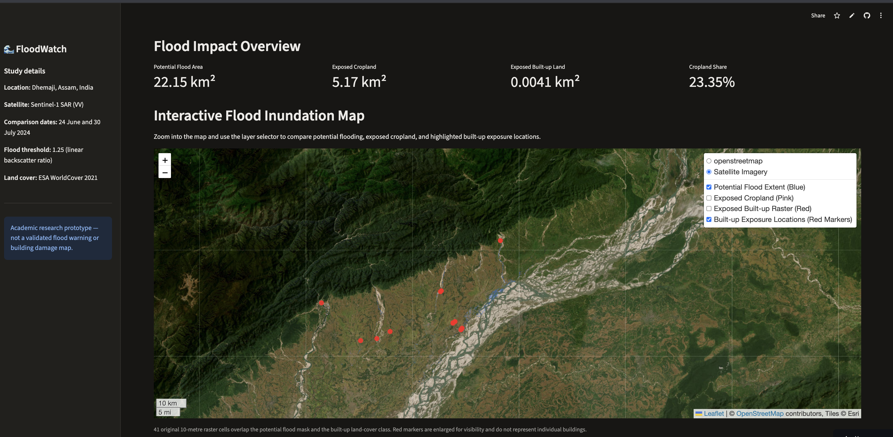

# 🌊 FloodWatch
## Satellite-Based Flood Inundation Mapping and Impact Assessment

FloodWatch is a satellite-based flood mapping and impact
assessment application developed using Google Earth Engine,
Sentinel-1 SAR imagery, Python, and Streamlit.

The project identifies potential flood-inundated areas and
estimates exposure of agricultural and built-up land.

## 🌐 Live Application

https://dhemaji-flood-mapping-2024.streamlit.app/

## 📸 Application Screenshot

## 📍 Study Area

- Location: Dhemaji District, Assam, India
- Satellite: Sentinel-1 SAR
- Polarization: VV
- Comparison dates: 24 June and 30 July 2024
- Land-cover dataset: ESA WorldCover 2021
- Spatial resolution: 10 metres

## 🎯 Project Objectives

1. Retrieve satellite imagery using Google Earth Engine.
2. Identify potential inundation using SAR change detection.
3. Estimate the area of detected flooding.
4. Assess cropland and built-up land exposure.
5. Visualize geographic results on an interactive map.
6. Develop and deploy an accessible web dashboard.

## 🛠️ Technologies Used

- Python
- Google Earth Engine
- Sentinel-1 SAR
- ESA WorldCover
- Rasterio
- NumPy
- Pandas
- Folium
- Streamlit
- Git and GitHub

## 🛰️ Methodology

### 1. Study Area Selection

Dhemaji district in Assam was selected as the study area.

Administrative boundaries were obtained using the
FAO GAUL dataset in Google Earth Engine.

### 2. Satellite Data Collection

Sentinel-1 SAR observations were retrieved through
Google Earth Engine.

The analysis uses VV polarization observations from
matching ascending relative orbit 143.

### 3. Flood Change Detection

Pre-event and flood-period radar backscatter composites
were compared.

The radar values were converted from decibels to linear
units before computing a backscatter change ratio.

A ratio threshold of 1.25 was applied to identify
candidate inundated pixels.

### 4. Filtering

The flood mask was refined using:

- Permanent-water masking
- Terrain slope filtering
- Connected-pixel filtering

### 5. Impact Assessment

Potential flood extent was overlaid with ESA WorldCover
2021 land-cover classes:

- Class 40: Cropland
- Class 50: Built-up land

### 6. Python Geospatial Processing

Exported GeoTIFF files were processed using Rasterio.

Pixel-based calculations were performed to estimate:

- Total potential flood extent
- Potentially exposed cropland
- Potentially exposed built-up land

### 7. Dashboard Development

A Streamlit dashboard was developed using Folium
to visualize the results geographically.

Users can switch between satellite and street-map
backgrounds, inspect flood layers, and download results.

## 📊 Results

Results calculated from the exported GeoTIFF files:

| Metric | Estimated Value |
|---|---:|
| Potential flood area | 22.1486 km² |
| Exposed cropland | 5.1719 km² |
| Exposed built-up land | 0.0041 km² |
| Cropland share of detected flooding | 23.35% |

These values are preliminary outputs of the flood-detection
algorithm and should not be interpreted as verified damage.

## 🖥️ Application Features

- Interactive satellite map
- Potential flood extent visualization
- Cropland exposure overlay
- Built-up exposure overlay
- Highlighted built-up exposure locations
- Flood-impact metric cards
- Land-cover exposure chart
- Statistical summary table
- CSV download
- Interactive HTML map download

## 📁 Project Structure

Satellite-Flood-Assessment/
    dashboard/
        app.py

    data/
        raw/
            dhemaji_flood_mask_2024.tif
            dhemaji_landcover_2021.tif
            dhemaji_impact_statistics_2024.csv

        processed/
            dhemaji_flood_impact_map.png
            python_impact_statistics.csv

    src/
        inspect_rasters.py
        calculate_impact.py
        visualize_flood.py

    README.md
    requirements.txt
    .gitignore

## 🚀 Run Locally

### 1. Clone the repository

git clone https://github.com/Janween-Thomas/Satellite-Flood-Assessment.git

### 2. Open the project

cd Satellite-Flood-Assessment

### 3. Create a virtual environment

python3 -m venv .venv

### 4. Activate the environment

On macOS/Linux:

source .venv/bin/activate

On Windows:

.venv\Scripts\activate

### 5. Install dependencies

python -m pip install -r requirements.txt

### 6. Launch the dashboard

python -m streamlit run dashboard/app.py

Open http://localhost:8501 in your browser.

## ☁️ Deployment

The application is deployed using Streamlit Community Cloud.

Live URL:

https://dhemaji-flood-mapping-2024.streamlit.app/

The source code and exported satellite analysis data
are hosted in this GitHub repository.

## ⚠️ Limitations

- Flood extent is estimated from radar change detection
  and has not been independently validated.
- Radar backscatter may change due to soil moisture,
  vegetation, and surface roughness.
- The threshold was selected experimentally.
- Permanent-water and terrain masks may exclude
  some flooded locations.
- ESA WorldCover 2021 may not reflect 2024 land cover.
- The satellite imagery may not cover all locations equally.
- The browser map uses downsampled raster previews.
- Built-up exposure does not establish building damage.
- The application does not provide live flood warnings.

## 🔮 Future Improvements

- Validation against independent reference flood maps
- Improved Sentinel-1 preprocessing
- Machine-learning-based flood classification
- Flooded road network assessment
- Population exposure analysis
- Multi-date flood monitoring
- Higher-resolution interactive map tiles
- Automated satellite processing for new events

## 📚 Data Sources

- Sentinel-1 SAR:
  https://developers.google.com/earth-engine/datasets/catalog/COPERNICUS_S1_GRD

- ESA WorldCover:
  https://esa-worldcover.org/

- Google Earth Engine:
  https://earthengine.google.com/

- FAO GAUL:
  https://developers.google.com/earth-engine/datasets/catalog/FAO_GAUL_2015_level2

## 👨‍💻 Project Information

Project: Satellite-Based Flood Inundation Mapping
and Impact Assessment

Institution: JECRC University

Study Area: Dhemaji, Assam, India

Purpose: Academic research and educational demonstration

---

**Disclaimer:** FloodWatch is an academic research prototype.
It is not an operational flood warning system and should not
be used for emergency planning or safety-critical decisions.
